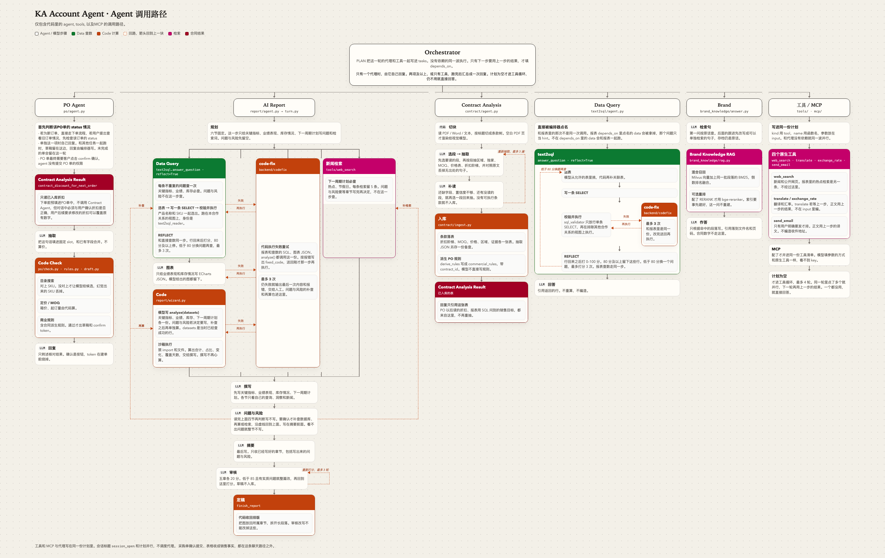

# KA Account Agent

面向品牌经销商的**对话式运营 agent**。聊天从 Orchestrator 进来，由它分给下面几条。



可编辑的原图在 [`docs/agent-call-paths.html`](docs/agent-call-paths.html)。图比较宽，点开可以看清字。

- **PO Agent**（`po/`）：对话建采购单。模型把消息填进固定 slot；产品、价格、MOQ、商业规则由代码计算。下单时读合同分析结果。用户确认后才提交。提交之后，同一条聊天处理收货、付款、破损索赔。
- **AI Report**（`report/`）：聊天里的报表草稿。它再去要 Data Query 和新闻 / 知识检索，叙述由模型根据这些结果来写。整洁销售表进事实表是另一条路（`spreadsheet.py`）。
- **Contract Analysis**（`contract/`）：读协议，抽出区域、独家、MOQ、价格表、折扣阶梯，带原文位置。结果入库，供 PO 和检索使用。
- **新闻 / 知识检索**：不是 agent。编排器直接走工具、品牌资料 RAG，以及已经入库的合同分析结果。
- **Data Query**（`text2sql/`）：自然语言变成一条 SELECT，校验后执行。AI Report 也会调用它。

采购单这一条沿用下来的约束：

1. **价格和规则由代码计算。** 模型只把对话填进 slot。产品解析、定价、MOQ、品牌商业规则不交给模型，模型也不选择提交路径。
2. **确认是一个动作，不是一个推断。** 提交需要按钮或 hash 绑定的链接。模型的"用户好像同意了"在小模型上实测是错的
   （"thanks" → 已确认），所以永远不采信。
3. **副作用幂等。** 提交以 confirm token 为键，token 在建单**之前**烧掉——双击、重试只产生一张订单。

## 目录结构

```
compose.yaml / Dockerfile / frontend/Dockerfile   Docker Compose：Postgres + Redis + Milvus + API + Celery worker + Vite
dev / dev.bat      所有命令的入口（容器里跑，不在宿主机起服务）
backend/
  orchestrator/    Orchestrator：开场、要一份计划、按名字调用；registry.json 在这里
    turn.py        只调度。每一步开始前先推一条 status，页面跟着更新
    prompt.py      PLAN、开场、工具循环、普通回答
    status.py      这一条 status 长什么样
    speak.py       把一条回复写进会话
  po/              PO Agent
    agent.py       一轮对话：索赔，或继续下单
    turn.py        抽取、校验、草稿、回复、确认
    prompt.py      采购单提示词；`fill` 替换 `{{slot}}`
    check.py rules.py draft.py slots.py submit.py    定价和规则
    catalog.py     产品索引 + 给 prompt 的目录清单
    claims.py      提交之后：收货 / 付款 / 破损，落到订单状态上
  report/          AI Report
    agent.py       聊天里的草稿
    prompt.py      固定大纲
    spreadsheet.py    整洁表格收成事实，不是 agent
  contract/        Contract Analysis
    agent.py       聊天里归档，并引用已入库的表
    prompt.py      合同抽取提示词
    read.py ingest.py chunks.py    读条款、入库
  text2sql/        Data Query
    agent.py       聊天里回答一个数据问题
    prompt.py      选表、写 SQL、引用查询结果
    sql_validator.py table_metadata.py    校验并执行那条 SELECT
  tools/           工具：BOCHA 新闻、汇率、发信、翻译
  mcp/             架构图里的 LinkedIn MCP。代码是 SocialCrawl（多平台社交/电商），并入工具列表
    prompt/        结构化检索表单；日常对话直接走 tools=
  brand_knowledge/ Brand Knowledge RAG。挂在「新闻 / 知识检索」下面，不是 agent
    answer.py      把跟进问题收成检索句，再根据段落作答
    prompt/        只根据检索段落作答
  llm/             模型客户端。外面只从这里 import
    client.py      发请求：complete_json / stream_text / complete（工具调用）
    parse.py       把模型返回的字符串收成 JSON
    types.py       ToolCall、一次助手回复
    fake.py        测试替身，不联网
  documents.py     PDF / Word / 文本 → 逐页文本；PDF 页渲染成 JPEG，给视觉模型看
  memory.py        长期记忆：跨会话记住的偏好 / 指令 / 事实，每轮 PO 对话作为上下文读入（只能提醒，不能放宽规则）
  db/              数据层：orm.py（表结构）、database.py（唯一入口）、migrations/（Alembic）
  schemas/         业务对象和 HTTP 请求体（Pydantic），按模块拆开。表仍在 db/orm.py
  router/          HTTP 路由：会话、目录、合同、报表、记忆、订单
  service.py       业务操作，不依赖传输层：handle_message（转发 orchestrator）/ confirm / orders
  app.py           组装入口：create_app 注入数据库和模型，挂上 router
  worker.py        Celery 应用。broker 是 Redis 1 号库，结果在 2 号库；0 号库仍是会话锁、并行结果、汇率
  tasks.py         交给 worker 的任务。`partnerdesk.ping` 用来确认 worker 在听
frontend/               桌面（Vite + React + TypeScript）：聊天 / 产品 / 订单 / 合同 / 报表 / 记忆，只调上面的 HTTP
scripts/           fetch_off_products.py 拉 Open Food Facts 快照到 data/off/；build_catalog.py（dev catalog）把它导入产品目录
data/              大数据集（Open Food Facts 快照），gitignore，不进仓库
tests/             不联网的测试（FakeLLM；页面行为由 HTTP 测试和 frontend/ 的 Vitest 覆盖）
docs/agent-call-paths.html   上面的调用路径，png 是嵌在这里的那张
docs/PartnerDesk.drawio   早一版的粗图
docs/porting/      从第一版带过来了什么、为什么（01–06）
```

## 数据层

所有业务数据都进数据库，按真实的表建模（列、外键、索引），不再有 JSON blob 表：

- **引擎**：SQLAlchemy 2.0 + PostgreSQL，没有第二个引擎。连接串由 Docker Compose 注入
  （`PARTNERDESK_DB_URL`），`postgres:17-alpine` 镜像会建好库本身。不保留 SQLite 回落是刻意的：双引擎意味着每个 schema 决策都要在两边都成立，
  原生类型（`timestamptz`、`jsonb`、数组、枚举）就一直用不上；而静默回落会让配置错误的部署
  在一个空库上正常启动，而不是当场失败。
- **schema 由 Alembic 版本化**（`backend/db/migrations`）。`Database()` 构造时自动升到 head，
  测试每个临时库也走同一套 migration；`tests/test_db.py` 会在模型和 migration 不一致时直接失败。
  改表：改 `db/orm.py` → `dev py -m alembic revision --autogenerate -m "..."` → 检查生成文件。
- **合同**：`contracts` 一行一份协议；`contract_extractions` 原样保存每次抽取的 JSON（审计 / 重跑）；
  折扣阶梯、MOQ、价格表、区域、原文证据各有自己的表；由合同派生的规则通过 `commercial_rules.contract_id` 追溯。
  下单时 `contract.contract_discount_for_next_order` 按合同年内已下单数选档，预填到订单里
  （假设：一张已提交的 PO = 一柜）。经销商在对话里说的折扣覆盖预填；超过合同最高档走审批规则。
- **品牌资料**：`brand_documents` 一行一份上传的文件（含原文件字节），`brand_document_pages` 是逐页文本。
  蒸馏成片段的链路已去掉。问答走 `brand_knowledge/rag.py`：向量检索和 BM25 混合召回，配了 `RERANK_*` 才用交叉编码器 `BAAI/bge-reranker-v2-m3` 重排。标注过的提问用同文件的 `evaluate_retrieval` 算 MRR、nDCG、Precision、Recall、MAP 和 Hit Rate。现有文本模型只根据命中的段落作答。解析仍走 `documents.py`。
- **销售报表**：`sales_reports` 一行一份文件，`report_extractions` 记录每次读取（列映射、跳过了什么），
  `report_facts` 按原生粒度存每个数字（metric_key / 渠道 / SKU / `product_id` / 期间 / 来源单元格）。
  事实是 draft，`Database.confirm_report` 才变 confirmed；同一合作关系同一测量同一期间的旧事实自动 superseded——重发不会翻倍。
  `product_id` 让报表的销量能和 `purchase_order_items` 按产品对上（报表页已有「下单 vs 售出」）。
- **产品目录**：真实的 Open Food Facts 食品（ODbL），约 41 万个、10 万个真实品牌。只收同时有英文名（拉丁字母）、
  标签原语言名（`product_name_native`，英文标签就等于英文名）和包装规格的产品。名称、品牌、类目、规格、标签是原数据；
  箱规、箱价、MOQ、托盘、箱重是按真实规格和类目**确定性推导**的（同一条码每次算出一样的数）；
  `product_status`（正品 / 赠品 / 样品 / 停产）里只有 OFF 标了 obsolete 的停产是真的，其余是推导的；
  `restricted_territories` 留空——原数据没有，不编。量大，所以 `./dev catalog` 用 COPY 一次性替换整张表，
  产品页的搜索、计数、分页都在数据库里做（名称和 SKU 有 trigram 索引）。目录不依赖合作关系；下单仍然要。
- **长期记忆**：`memories` 按合作关系存偏好 / 指令 / 事实 / 事件，`is_active` 控制是否读入；
  每个代理的提示都会带上 active 记忆——只是上下文，进不了 code-check，也不能改价。一次聊天自己的滚动摘要另存在会话上，不进这张表。

## 现状

| 能力 | 状态 |
|---|---|
| slot 模板 + merge 语义 | 已移植 — `po/slots.py` |
| 确定性校验（搜索 → LLM 兜底解析 → 定价 → MOQ → 规则 → 缺项） | 已移植 — `po/check.py`、`po/rules.py` |
| 抽取（LLM，结构化输出，支持图片） | 已移植 — `po/extract.py` |
| 草稿 + 摘要 + hash | 已移植 — `po/draft.py` |
| 流式回复 | 已移植 — `po/reply.py` |
| 一轮对话 + 确认门 + 提交 | 已移植 — `po/turn.py`、`po/submit.py`、`service.py` |
| 多页桌面：聊天 / 产品 / 订单 / 合同 / 报表 / 记忆 | **新增** — `frontend/`（Vite + React），对接 `app.py` 挂上的 router |
| 产品目录：Open Food Facts 真实食品 + 推导的批发字段，多品牌；产品页库内搜索分页 | **新增** — `scripts/`、`frontend/` 产品页；全目录进 prompt 待改成检索（RAG） |
| 意图 / 聊天入口 | 已改 — `session_open`（首次 title+tags）+ `PLAN`（tools/MCP/agents）；无代码侧 route |
| 提交后的收货 / 付款 / 索赔 | 已移植 — `po/claims.py` |
| 合同全量入库 + 条款 → PO 规则 + 合同折扣预填 | **新增** — `contract/`、`db/` |
| 合同页：上传协议（PDF / Word / 文本）或导入抽取 JSON；条款 / 派生规则 / 证据 | 已接入 — `contract/`、`frontend/` 合同页；模型填条款，代码派生规则 |
| 报表：整洁表格 → 事实 → 确认 → 取代；报表页 + 图表 + 下单 vs 售出 | **新增** — `report/spreadsheet.py`、`frontend/` 报表页；多块乱表（06）待做 |
| 品牌资料：文件 + 逐页文本留在库里；问答时按品牌做混合检索 | 最小 RAG — `brand_knowledge/rag.py`；需先 `index_brand`，embedding 与聊天模型分开配；重排默认 `BAAI/bge-reranker-v2-m3`；标注集用 `evaluate_retrieval` 打分 |
| 长期记忆：记忆页 + 每轮 PO 对话读入 | **新增** — `memory.py`、`frontend/` 记忆页 |
| 聊天里的合同 specialist | 已接入 — 附上协议文件即抽取并入库；只有文件名、没有文件内容时会要求重传 |
| 聊天里的报表 specialist | 占位 — 设计和 prompt 在 `docs/porting/06-report-core.md` |
| 聊天里引用品牌资料 | 已接入 — 首问按原话检索；后续跟进由编排器补成独立问句再检索，原话照原样保存。回答下标出文件名和页码。合同 / 报表数字的引用仍待做 |

## 运行

本机只需要 **Docker Desktop**。不要再起 PostgreSQL、Python venv 或 Vite。

第一次：`cp .env.example .env`，填校园网模型 key（需校园网或 VPN）。聊天下拉里的地址和调用名在 `backend/llm_config.py`，不写在 `.env`。
**不要**填 `PARTNERDESK_DB_URL`、`PARTNERDESK_REDIS_URL`、`MILVUS_URI`——Compose 会注入容器内网地址。

然后：

```
./dev
```

| | |
|---|---|
| 桌面 | http://localhost:5173 |
| API | http://127.0.0.1:8000/docs |
| 停掉 | `Ctrl+C`，或另开终端 `./dev kill`（数据卷保留） |

Postgres、Redis、Milvus 只在 Compose 网络里，不往本机暴露端口。镜像已经 build 过的话，`./dev` 只是起容器。Milvus 第一次要拉一个比较大的镜像，起来也比 Postgres 慢。

Celery worker 和 API 用同一份镜像，`./dev` 和 `./dev api` 都会把它拉起来。broker 是 Redis 的 1 号库，任务结果在 2 号库；0 号库仍是会话锁、并行结果和汇率缓存。任务在进程启动时导入，改了 `backend/tasks.py` 之后 `docker compose restart worker`（源码是挂载进去的，不用重新 build）。依赖变了才要 `./dev build`。

产品目录可选（约半小时拉数据 + 几分钟入库）：

```
./dev py scripts/fetch_off_products.py
./dev catalog
```

其它命令（Windows 用 `dev.bat`）：

```
./dev api        只起 API + Celery worker + Postgres + Redis + Milvus     http://127.0.0.1:8000/docs
./dev db         只起 Postgres
./dev catalog    导入产品目录（data/off/ 快照；--dry-run 只统计不写库）
./dev test       pytest（假模型，真 Postgres）
./dev test-web   前端 Vitest
./dev lint       ruff
./dev py ...     容器里的 python
./dev build      依赖变了才需要（pyproject.toml / frontend/package.json）
./dev kill       停掉栈，保留 Postgres 数据卷
```

基础镜像默认 DaoCloud，pip / npm 默认清华和 npmmirror。能直连 docker.io 时，把
`POSTGRES_IMAGE` / `REDIS_IMAGE` / `MILVUS_IMAGE` / `PYTHON_IMAGE` / `NODE_IMAGE` 改回官方名即可。

## 可选依赖

| extra | 内容 |
|---|---|
| `contract` | Word 用 python-docx；PDF 页图用 PyMuPDF。PDF 正文走 GLM-OCR（`GLM_OCR_API_KEY`） |
| `dev` | pytest、httpx、ruff |
| `catalog` | pyarrow：拉 Open Food Facts 快照、导入产品目录 |
